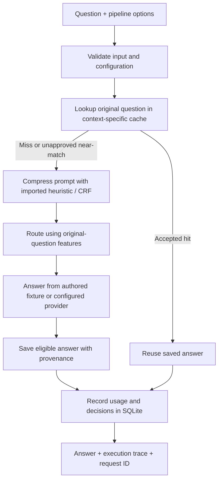

# Token Optimiser

**A CPU-first workbench for English, Hinglish and Hindi LLM requests.**

Token Optimiser connects answer reuse, prompt compression, model selection and token analytics through one FastAPI pipeline. The React Studio returns an answer alongside the actual execution trace, source labels, reference-token counts and any provider-reported usage.

Built for the Introduction to Machine Learning course at **IIIT Allahabad**. The default demonstration uses local algorithms and explicitly authored answers; it needs no API key, GPU, Redis server or answer-model download.

## Start the application

Requirements: **Python 3.11+**, **Node.js 22+**, and npm. Run from the repository root:

```sh
python scripts/setup.py
npm run dev
```

| Service | Address |
| --- | --- |
| Request Studio | http://127.0.0.1:8080 |
| Interactive API documentation | http://127.0.0.1:8000/docs |
| Health and configured provider readiness | http://127.0.0.1:8000/api/v1/health |

Setup creates `.venv`, installs the declared backend development dependencies and the frontend lockfile, and reuses the committed routing artifacts. It trains the small CPU classifiers only if artifacts are missing or `--retrain-router` is explicitly supplied. Installing dependencies requires internet access; the reference tokenizer may fetch its vocabulary once. After dependencies and vocabulary are cached, the default demo runs locally.

No `.env` file is required for demo mode. Stop both development processes with **Ctrl+C**. Restart the backend after changing Python code or configuration; the combined launcher does not enable Python auto-reload.

## The request pipeline



The browser makes **one `POST /api/v1/chat` call**. Core orchestration connects the feature adapters on the server; feature pages remain available for deeper inspection.

1. **Cache:** lookup uses the original question. An accepted hit skips compression, routing and generation. Approximate reuse is opt-in; the matched question and similarity remain visible.
2. **Compression:** execute the pinned heuristic or CRF adapter, retaining actual-method and fallback information. Selected literal guards can retain the original prompt if an occurrence disappears.
3. **Routing:** score original-question features with the saved CPU classifiers and apply the economy, balanced or quality policy. The selected tier chooses the configured model ID in live mode.
4. **Answer:** demo mode formats an authored support fixture and applies a local reference-token cap. Live mode sends the compressed prompt, format instruction and `max_tokens` to the selected OpenAI-compatible endpoint.
5. **Insights:** record one successful request with its source, stage decisions, reference counts, optional provider usage and optional configured-price calculation.

Cache contexts include browser scope, mode, language setting, model IDs, endpoint, routing policy, compression options, output options and a pipeline version. Changing these options creates a separate context. **Manage this pipeline cache** opens the matching entries for inspection or deletion.

## Five-minute demonstration

| Step | Action | What to show |
| --- | --- | --- |
| 1 | Open Studio and run **Hinglish support** | Authored answer, actual compression, selected tier and five-stage trace |
| 2 | Click **Repeat this request** | Exact cache hit; compression, routing and generation skipped |
| 3 | Change policy or disable cache and run again | A fresh execution and the policy threshold; the tier may stay the same |
| 4 | Choose **JSON only**, set an output cap and run | Valid locally formatted demo JSON; explicit notice if the answer was shortened |
| 5 | Open **View request history** | The recorded language, route, cache state and answer provenance |
| 6 | Open Compression, run an analysis and select **Send to Request Studio** | Checked final text transferred with compression disabled to avoid a second pass |

English library and Hindi assignment presets exercise the same endpoint. Answers remain authored fixtures in all languages; the demo does not translate or generate arbitrary answers. Unknown topics receive a labelled generic fallback which is not learned by the cache.

For a repeatable rehearsal using disposable SQLite data:

```powershell
.venv\Scripts\python.exe scripts/check_pipeline.py
```

See [the complete demo guide](docs/demo.md) and [the merge/integration audit](docs/integration-audit.md) for the report findings and verification boundaries.

## Workspaces and machine learning

| Workspace | Capability | Interpretation |
| --- | --- | --- |
| Studio | Integrated request-to-answer flow and audit trace | Demo fixtures or explicitly configured live generation |
| Compression | Heuristic / CRF, source/output diffs, protected phrases, method comparison | Literal retention is not proof of semantic equivalence; the budget is a target check |
| Routing | Logistic regression, random forest, MLP, policy thresholds and explanations | Scores measure agreement with authored complexity labels, not answer correctness |
| Memory & Cache | Exact and approximate lookup, SQLite persistence, TTL, management; optional Redis/local embeddings | Similarity can miss changed details; browser scopes are not authentication |
| Insights | Reference token comparisons, scenario costs, ridge length prediction, PCA / k-means and history | Estimates use authored fixtures; regression metrics are training fit and clusters are exploratory |

Historical compression evidence is displayed separately with pinned provenance. It is not a measurement of this demo's throughput, answer quality or billing.

## Optional live provider

Copy `.env.example` to the ignored `.env` file and configure the backend:

```dotenv
IML_MODE=live
IML_API_BASE_URL=https://your-provider.example/v1
IML_API_KEY=your-server-side-key
IML_CHEAP_MODEL=your-economy-model-id
IML_STRONG_MODEL=your-strong-model-id
```

Restart `npm run dev`, then select **Live provider** in Studio. Both model IDs are required. Health reports configuration readiness, without probing the provider. Provider failures return visible errors; they do not silently become demo answers or successful history records.

Prices are optional, in **USD per million tokens**:

```dotenv
IML_CHEAP_INPUT_PRICE=0.10
IML_CHEAP_OUTPUT_PRICE=0.20
IML_STRONG_INPUT_PRICE=1.00
IML_STRONG_OUTPUT_PRICE=2.00
```

These example numbers are user assumptions, not a current provider price list. With no configured prices, live cost is **unknown**. Provider-reported usage is kept separate from reference counts; absent usage stays absent. Calculated cost is an estimate, not an invoice. Demo and cached requests make no provider call.

API keys stay server-side. Live requests are sent only after deliberate configuration and selection. This course demo has no authentication or deployment capacity guarantee; run it locally.

## Verify changes

From the repository root on Windows:

```powershell
.venv\Scripts\python.exe -m pytest backend/tests -q
npm run check
.venv\Scripts\python.exe scripts/check_pipeline.py
```

On macOS/Linux, replace `.venv\Scripts\python.exe` with `.venv/bin/python`.

`npm run check` runs TypeScript checking, Vitest and the production build. Backend tests isolate their databases from the demo and cover feature adapters plus the real chat endpoint, cache short-circuiting, context isolation, multilingual inputs, literal guards, cap boundaries and simulated provider responses/errors. Provider tests make no paid calls.

## Repository map

```text
src/app/                         Studio and application navigation
src/features/                    Four feature workspaces and clients
src/lib/                         Shared pipeline client and browser scope
backend/src/gateway/core/        Orchestration, settings, provider and SQLite store
backend/src/gateway/features/    Feature APIs and application adapters
backend/src/gateway/modules/     Pinned imported Research implementation
backend/data/fixtures/           Authored demo answers and ML examples
backend/data/artifacts/          Saved CPU routing classifiers and metrics
backend/data/runtime/            Ignored local SQLite state
backend/tests/                   Feature and pipeline regression checks
contracts/                      Request/response documentation
docs/team/                      Ownership and original task sheets
```

| Team member | Feature ownership |
| --- | --- |
| Tushar Saharan | Compression |
| Rakesh Mali | Routing |
| Shivam Kumar | Memory & Cache |
| Aman Kashyap | Token & Cost Insights |

Shared core integration connects these independently owned features. Imported implementations retain their own attribution; see [source attribution](docs/source-attribution.md), the [Research manifest](docs/source-manifest.json) and the [router reference import](docs/router-import.md).

## Troubleshooting

- **Port already in use:** stop the previous application instance, or set `IML_DEV_WEB_PORT=8081` and `IML_DEV_API_PORT=8001` in the shell before `npm run dev`. See [setup](docs/setup.md) for commands.
- **Backend unavailable or `/chat` returns 404:** restart the backend from this checkout. An older running process will not register the new endpoint.
- **CRF or routing fallback:** inspect the trace and feature page. Missing or incompatible artifacts are labelled; they are not presented as successful learned execution.
- **Whitespace tokenizer:** the reference vocabulary is unavailable. Once internet is available, warm it with `.venv\Scripts\python.exe -c "import tiktoken; tiktoken.get_encoding('cl100k_base')"` and restart.
- **Unexpected cache miss after changing controls:** context isolation is deliberate. Repeat with the same options, or inspect the matching cache through the result link.
- **Unchanged compression:** the imported methods do not promise a requested reduction. A 100% budget retains the original; literal protection may also force original-text fallback.
